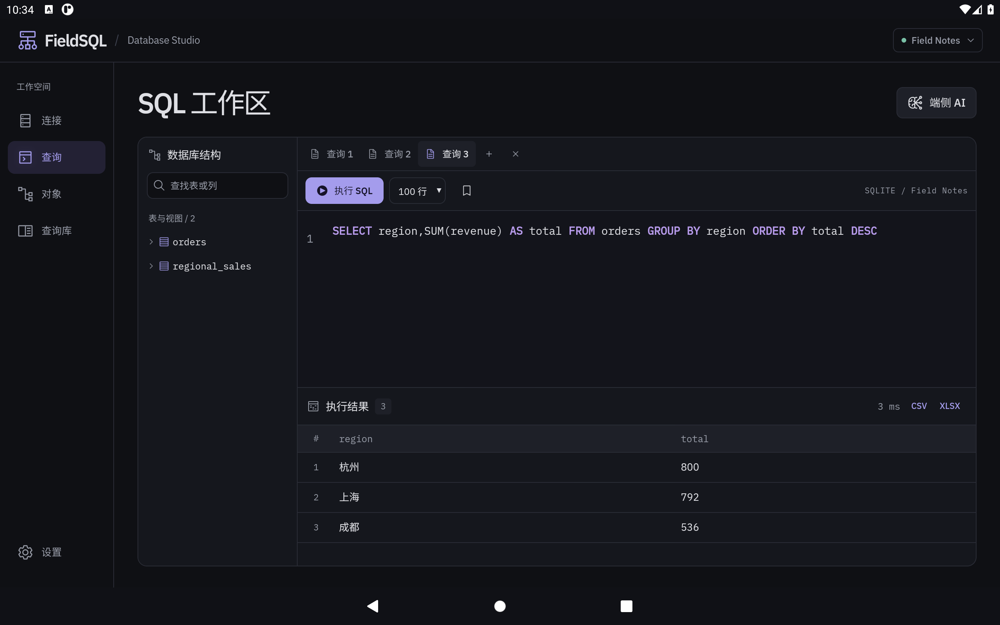

# FieldSQL · Android 数据库工作台

在 Android 手机或平板上浏览 PostgreSQL、MySQL、MariaDB 和 SQLite，也可以让设备本地的小模型根据表结构写 SQL。无需 FieldSQL 账户。

**[下载 Android 安装包（ARM64）](https://github.com/Garry-Tang-274/FieldSQL-Android/releases/download/v0.1.2/FieldSQL-0.1.2-arm64.apk)** · [0.1.2 更新说明](docs/release-0.1.2.md) · [所有版本](https://github.com/Garry-Tang-274/FieldSQL-Android/releases)

**第一次使用，先看一张表：** 在 **数据源** 找到本机示例库 **Field Notes**。手机点数据源行下方的 **浏览表**；平板先选中数据源，再点右侧的 **浏览表**。点表名 `orders` 就能看原始订单，不用先写 SQL。要试汇总查询，打开该库的 SQL 工作区并执行预置语句，结果应为杭州 800、上海 792、成都 536。

## 让 AI 在手机上写一条 SQL

1. 在 **查询 → 端侧 AI** 点 **下载推荐模型 · 1.12 GB**（[界面示例](docs/screenshots/download-model.png)）。也可以从 **设置 → 端侧 AI** 进入，无须先连接数据库。
2. 推荐的 Qwen2.5-Coder 1.5B 下载量为 **1.12 GB**，建议使用 Wi-Fi，并至少预留 1.12 GB 存储空间。模型从 Qwen 的官方 Hugging Face 仓库下载到这台设备，不用在电脑上另下或传文件。下载完成后应用选用该模型；已有 GGUF 的用户仍可手动导入。
3. 在 Field Notes 中输入 **“按地区汇总订单销售额，按总额从高到低排序”**。先看生成的 SQL 是否使用 `GROUP BY region` 和降序排序，再点 **放入编辑器 → 执行 SQL**。推理时不需要联网、API Key 或电脑服务。

APK 面向 **64 位 ARM Android 8.0+**，本地 AI 需要 **Android 9.0+** 和足够的可用内存。使用 CPU 推理；1.5B 是推荐模型，空间紧张可选 0.5B。数据库连接可访问远程服务器，本地 SQLite 数据库和已下载模型的推理不依赖外网。手机的系统 WebView 应保持更新。

## 浏览表，再回到原来的工作位置

已连接时，点导航中的 **浏览表**，再点表名，默认打开[数据表格](docs/screenshots/table-rows.png)。在平板 SQL 工作区，也可以点左侧结构树中表名旁的**网格按钮**直接看行；点列名则把该列插入 SQL 光标处。列、索引和建表语句可在对象详情内切换。

在**同一连接**内往返查询、浏览表等页面，会保留当前表、页码、筛选和未提交的草稿；SQL 标签分别保留选区、光标、撤销记录和编辑器内的滚动位置。切库、断开连接或结束进程后，请不要依赖这些临时状态。要长久保留 SQL，在查询编辑器点 **收藏**，以后可从 **查询库** 找回。

查询编辑器支持表列补全和外接键盘 Ctrl/Cmd+Enter。查询库还保留最近 500 次执行。写入和改表前会显示 SQL 确认；修改已有行需要准确主键。**CSV/XLSX** 导出的是当前查询结果或当前数据页，不是整库备份。

## 连接自己的数据库

在 **数据源 → 新建连接** 选择 PostgreSQL、MySQL 或 MariaDB，填写数据库域名、端口、库名、账号和密码。默认开启 TLS（传输层安全协议），校验服务器证书和主机名。需要 SSH 跳板机时，再选择 SSH 私钥并填入管理员提供的主机指纹。SSH 指纹不代替数据库证书。连接配置和凭据由 Android Keystore 保护的密钥加密保存在本机。

**如果提示「无法验证服务器证书」：**

1. 向数据库服务商或管理员取得**签发该服务器证书的 CA 证书**。FieldSQL 支持 X.509 PEM（一张或多张 CA）和单张 DER；`.crt` 文件也要符合其中一种格式。不要选择 ZIP、服务器叶证书、私钥或 Java 密钥库。
2. 点失败提示中的 **导入 CA 证书**，在 TLS 区域选择文件，再点 **保存并重连**。应用会自动重试刚才的操作，打开原先要看的表列表或 SQL 工作区。
3. 如果是提前配置，从数据源进入 **编辑连接 → TLS → 导入 CA 证书**，选择文件后点 **保存**。接着点该数据源的 **浏览表** 即可使用新配置连接。[查看证书入口截图](docs/screenshots/connection-ca.png)

证书只用于这条连接，不改变 Android 系统信任设置。若提示**主机名不匹配**，请使用服务器证书「使用者可选名称」（SAN）里的数据库域名；用 IP 连接时，证书须列有该 IP。只有旧式通用名称（CN）而没有匹配 SAN 的服务器证书需重新签发，重复导入 CA 无法修复名称错误。

**阿里云 RDS MySQL：** 使用已开启的云端证书时，在 [RDS 实例列表](https://rdsnext.console.aliyun.com/rdsList/basic) 选择地域和实例 ID，进入 **数据安全性 → SSL → 下载CA证书**。解压并选择 `ApsaraDB-CA-Chain.pem`，不选同包的 JKS 或 P7B。连接时填写启用该证书的内网或外网域名。若实例使用**自定义证书**，应向管理员取得其签发 CA，而不是套用云端证书包。若 SSL 尚未开通，先与管理员安排变更：开启或关闭会导致实例重启或切换。[阿里云云端证书说明](https://help.aliyun.com/zh/rds/apsaradb-rds-for-mysql/configure-a-cloud-certificate-to-enable-ssl-encryption#1bf77be069zxo) · [自定义证书说明](https://help.aliyun.com/zh/rds/apsaradb-rds-for-mysql/configure-a-custom-certificate)

## 对照 MonoDB

参考产品是 [Wovex MonoDB 的 Android 商店页](https://play.google.com/store/apps/details?id=com.wovex.mono_db) 及[开发者隐私说明](https://wovexapp.com/mono_db/privacy-policy)。FieldSQL 是独立应用，包名 `dev.fieldsql.app`，可与原版并存。

| 公开功能 | 本版实现 |
|---|---|
| Pro 五项 | SSH 私钥隧道、连接配置和 SQL 标签不设数量配额、行编辑不计次、无广告。无会员账户或购买入口。 |
| 对象与编辑 | 表/视图/过程/函数（按引擎）；数据、列、索引、DDL；主键行增改删、外键提示、增列、MySQL/MariaDB 支持的列调序。 |
| 查询与导出 | 多标签、表列补全、危险语句确认、20/50/100/500 或 1–10000 自定返回行数，收藏、500 条历史、CSV 及原生 XLSX。 |
| 切库与连接 | MySQL/MariaDB 使用 USE，PostgreSQL 重连目标库；连接超时设置中的查询时限按每个远程配置保存。 |
| 本机 AI | GGUF 导入、Qwen 下载、多模型切换/删除、中文请求生成 SQL、解释与修正、当前会话记录。SQL 只回填为草稿。 |
| 移动系统 | 深浅色与跟随系统、中英日韩西主要界面、平板/分屏布局、生物识别锁、后台连接通知、列出已保存连接的桌面小组件。 |

**与原版的具体差别：** 本地模型路线是 llama.cpp + GGUF，而不是复用 Wovex 的模型 CDN。PostgreSQL 表 DDL 是依据列与约束重建的结构预览，索引另页展示，不是完整的 `pg_dump`。不把原版付费、广告或分析服务集成进应用。兼容性按上面的系统版本和架构判断；真机推理速度要看芯片和内存。系统文件选择器及数据库服务器本身返回的提示使用各自的语言。

## 源码与构建

原生壳、连接与 Android 文件/密钥交互在 `app/`；驱动与 SSH 在 `db/`；端内推理与模型管理在 `ai/`。前端全部随包离线交付。设计来源见 [DESIGN.md](DESIGN.md)，实测范围见 [VERIFICATION.md](VERIFICATION.md)。第三方许可放在模块的 `assets/licenses` 和 `ai-fonts` 内；模型权重不随 APK 或 Git 仓库分发，[推荐模型的来源及许可](ai/models/NOTICE.txt)单独列出。

- JDK 17/21、Android SDK 35、Build Tools 35.0.0、随项目的 Gradle Wrapper。Android Studio 可直接打开根目录。
- Windows 本机签名构建：`./build-local.ps1`（设置 `ANDROID_HOME` 或传 `-Sdk`）。脚本使用当前 Windows 用户独立的签名密钥，不随源码包交付。另一台电脑重新签名的 APK 不能覆盖安装本发行包。
- 单纯重编 APK 不需要 Node。改动编辑器或设计依赖时，在 `ui-kit/` 执行 `npm ci` 与 `npm run build` 后再构建。普通调试构建可直接执行 `gradlew.bat :app:assembleDebug`。
- MariaDB Connector/J 的对应源码随 `third-party/` 提供，可替换依赖后重新构建。开源 UI 依赖版本固定在 `ui-kit/package-lock.json`。
